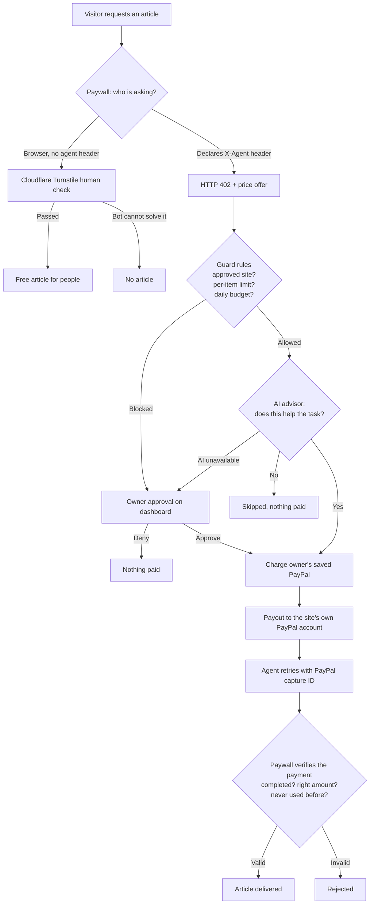
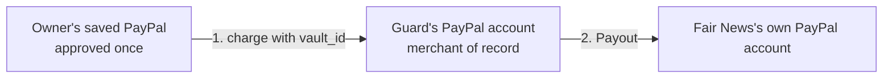
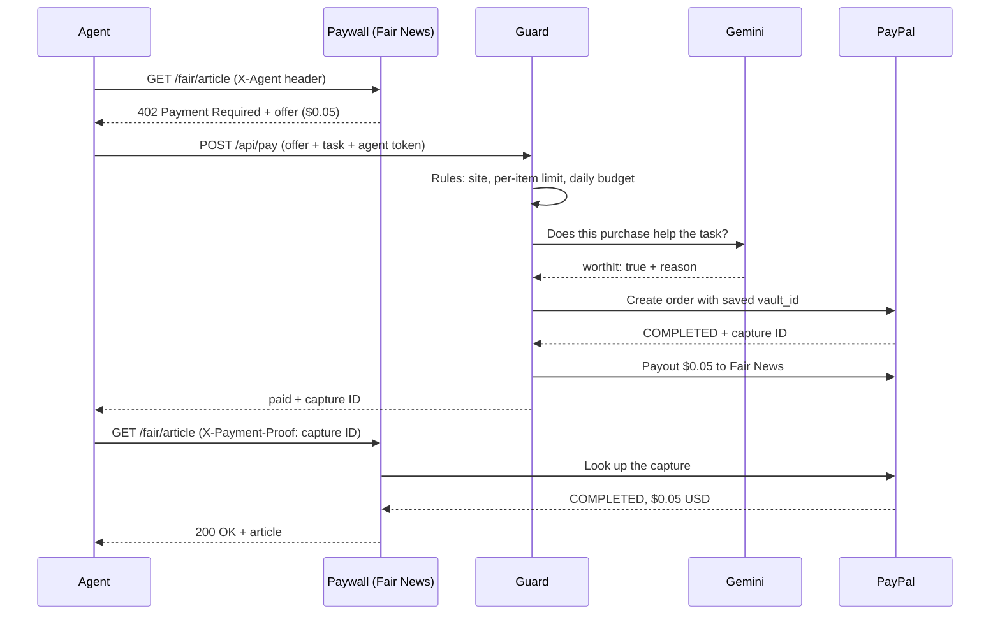

# AI Spending Guard

**Let AI agents pay for content safely, while websites get paid and people still read free.**

AI crawlers can now pay websites per article over **HTTP 402 Payment Required**. Two things are missing:
nothing stops an agent from **overspending or paying for junk**, and nothing stops a website from being
"paid" with **fake or reused proof**. AI Spending Guard covers both sides of that payment, using
**PayPal** to move the money and **Google Gemini** for judgment.

> Sandbox prototype · no real money · built for the PayPal AI Hackathon 2026

**Who it's for:** people and teams who let AI agents buy data or articles but don't want to hand them a
blank cheque, and publishers who want AI agents to pay instead of scraping, without charging human readers.

---

## Try it live

| What | Link |
|---|---|
| **Owner dashboard** | https://ai-spend-guard.onrender.com (sign-in details are in the Devpost testing instructions) |
| **Demo news site** | https://ai-spend-guard-paywall.onrender.com/fair/article |

**Two-minute tour:**

1. Sign in and click **Run agent**. The agent visits three paywalled news sites:
   - **Fair News** ($0.05, useful) → paid automatically, and the money goes to **Fair News's own PayPal account**.
   - **Gossip Daily** ($0.05, off-topic) → vetoed by the AI.
   - **Greedy News** ($50.00) → paused under **Waiting for your approval**. Approve or deny it.
2. Change **Your spending limits** (for example $60 per item, $100 per day) and run again. Greedy News now
   passes the rules, and the AI still vetoes it as a rip-off. Two independent checks.
3. Open a news site **in your browser**: pass the Cloudflare check and read free. Then try the same URL
   **as an agent**:

   ```
   curl -i -H "X-Agent: demo" https://ai-spend-guard-paywall.onrender.com/fair/article
   ```

   You get `HTTP/1.1 402 Payment Required` with a price instead.

Agent runs on the hosted demo are limited to 10 per hour.

---

## How it works



### Side 1: the website, "declare and pay, or prove you're human"

| Visitor | Sends | Gets |
|---|---|---|
| A person in a browser | nothing special | A Cloudflare Turnstile check → **free article** |
| An honest AI agent | `X-Agent: <name>` header | **HTTP 402** with a price → pays → article |
| A bot pretending to be human | nothing special | The human check, which it can't pass |

When an agent comes back with payment proof, the paywall checks with PayPal that the payment is
`COMPLETED`, for the **right amount** and currency, and **never used before**. Used proofs are saved to disk,
so a payment can't be replayed even after the paywall restarts.

### Side 2: the agent owner, "pay for small, sensible things; ask me about the rest"

Every purchase goes through three layers, in this order:

1. **Rules (always first):** approved sites only, a per-item limit, and a daily budget. The owner can change
   both limits on the dashboard. If the rules block a purchase, it waits for the owner.
2. **AI advisor (Gemini):** asked only if the rules allow the purchase: *does this help the agent's task?*
   - The AI can only **veto**. It can never approve anything the rules didn't allow.
   - If the AI call fails, the request goes to the owner. It is never paid automatically.
3. **Owner:** approves or denies paused requests on the dashboard.

### Where the money goes



The guard charges the owner's saved PayPal (no popup, no login per payment), then immediately sends the
money to the site's own PayPal account with **PayPal Payouts**. You can see each payment arrive in the
Fair News sandbox account.

### One payment, step by step



---

## Architecture

| Part | File | Holds secrets? | Job |
|---|---|---|---|
| **Guard** | `server/server.js` | Yes: PayPal, vault ID, Gemini | Owner sign-in, rules, AI check, payments, payouts, approvals, log |
| **Paywall** | `server/paywall.js` | PayPal (to verify only) | 402 offers, human check, payment verification, replay protection |
| **Agent** | `agent.js` | **No** | Visits sites, asks the guard to pay |
| **Dashboard** | `client/dashboard.html`, `client/login.html` | No | Sign in, run agent, set limits, approve/deny, view log |

**The agent never holds payment credentials.** The guard starts it with only its task, two URLs, and a
one-time token. The token lets it ask the guard to pay and check an approval's status, nothing else: it
can't change limits, approve its own requests, or reach PayPal.

---

## PayPal, AI, and other tools

| Technology | Used for |
|---|---|
| **PayPal Orders v2 + Vault** (save during purchase) | Owner approves once; their PayPal is saved for later charges |
| **PayPal Orders v2 with `vault_id`** | Charges with no buyer present |
| **PayPal Payouts** | Sends each article payment to the site's own PayPal account |
| **PayPal Captures API** | Paywall verifies each payment proof |
| **PayPal OAuth 2.0** (client credentials) | Server-side authentication |
| **Google Gemini** (`gemini-3.5-flash`) | Veto-only advisor: does this purchase help the agent's task? |
| **Cloudflare Turnstile** (test keys) | Human verification on the paywall |
| **Render** | Hosting for the guard and the paywall |

---

## Run it yourself

### Prerequisites

- **Node.js** 18 or newer
- A **PayPal Developer** account with a **sandbox app** (REST API credentials)
  - Under the app's features, enable **Save payment methods** (and **Payouts**, to pay sites)
  - Sandbox accounts: one **Personal** (the buyer), one **Business** (the guard's account), and optionally a
    second **Business** account for Fair News
- A **Gemini API key** from Google AI Studio

### 1. Install

```
git clone https://github.com/Swarna2503/ai-spend-guard.git
cd ai-spend-guard
npm install
```

### 2. Configure

```
cp .env.example .env
```

Fill in at least `PAYPAL_CLIENT_ID`, `PAYPAL_CLIENT_SECRET`, and `GEMINI_API_KEY`. See the configuration
table below for the optional settings.

### 3. Start everything with one command

```
npm run demo
```

```
[paywall] Paywall running on http://localhost:9000
[guard]   Node server listening at http://localhost:8888/
```

### 4. Connect PayPal (one-time owner setup)

1. Open **http://localhost:8888/connect**.
2. Pay with your sandbox **Personal** account (not Business: the Business account is the merchant and
   can't pay itself).
3. The vault ID is saved automatically to `data/vault.json`, and the dashboard shows **PayPal connected**.

**Fallback:** if checkout fails in sandbox, copy `payment_source.paypal.attributes.vault.id` from the
browser console into `PAYPAL_VAULT_ID` in `.env`, then restart. If the PayPal popup keeps logging into the
Business account, use a fresh private window.

### 5. Use it

Open **http://localhost:8888** (sign in if you set `OWNER_PASSWORD`) and click **Run agent**:

| Site | Price | Outcome (default limits) | Decided by |
|---|---|---|---|
| Fair News | $0.05 | **Paid** automatically, sent to Fair News | Rules + AI |
| Gossip Daily | $0.05 | **Skipped** (off-topic) | AI |
| Greedy News | $50.00 | **Paused** for approval | Rules → you |

### Configuration

| Variable | Required | Purpose |
|---|---|---|
| `PAYPAL_CLIENT_ID`, `PAYPAL_CLIENT_SECRET` | Yes | The guard's PayPal sandbox app |
| `GEMINI_API_KEY` | Yes | AI advisor |
| `PAYPAL_VAULT_ID` | Fallback | Used if `data/vault.json` doesn't exist |
| `FAIR_PAYEE` | No | Fair News's PayPal email; when set, Fair News payments are paid out to it |
| `OWNER_USER`, `OWNER_PASSWORD` | No | Owner sign-in. Without a password, the dashboard is open (local use) |
| `SESSION_SECRET` | No | Keeps the owner signed in across restarts |
| `PAYWALL_URL`, `GUARD_URL` | No | Defaults: `http://localhost:9000`, `http://localhost:8888` |
| `TURNSTILE_SITEKEY`, `TURNSTILE_SECRET_KEY` | No | Real Cloudflare keys for production (defaults are test keys) |

---

## Security decisions

- **The agent gets no secrets.** It's started with a minimal environment and a one-time token that only
  allows asking to pay and checking approvals.
- **Owner sign-in** with a signed, HttpOnly session cookie. Only the owner can run the agent, change limits,
  and approve or deny.
- **The AI can only veto.** A website's description could try to manipulate the AI (prompt injection);
  even a fooled AI cannot spend beyond the rules.
- **Fail safe.** If the AI is unavailable, requests go to the owner, never straight to payment.
- **Payment proofs are verified with PayPal**, and each proof works only once, even across restarts.
- **No double charges.** Approving marks a request as `charging` before calling PayPal.
- **Untrusted text is never rendered as HTML.** Site descriptions are escaped or shown with `textContent`.
- **Money math in cents** to avoid floating-point errors.

---

## What I built vs. what I reused

- **Reused:** PayPal's [`docs-examples/save-payment-method`](https://github.com/paypal-examples/docs-examples)
  (Apache 2.0): the checkout page, OAuth helper, and vaulting during purchase.
- **Built:** server-side charging of the saved PayPal method, payouts to sites, the rules engine and
  editable limits, the Gemini advisor, owner approvals and sign-in, the paywall with HTTP 402 offers,
  PayPal payment verification and replay protection, human verification with Turnstile, the agent,
  the dashboard, and hosting.

## Inspiration

**CrawlerPal** (PayPal Dev Days 2025 winner) showed that bots can pay websites via HTTP 402 using a saved
PayPal method. Its gap: the bot pays whatever it's asked. This project adds the missing spending controls
on the agent side, and human access plus payment verification on the website side.

---

## Honest limits (and what I tested)

- **Prototype, sandbox only.** No real money moves.
- **The guard is the merchant of record.** It charges the owner, then pays the site via Payouts. I tested
  charging the owner's saved PayPal with Fair News as the payee directly: PayPal returned
  `BILLING_AGREEMENT_NOT_FOUND`, because a saved method can only be charged by the merchant it was saved
  with. Paying sites directly would need PayPal's partner platform.
- **The platform verifies, the merchant receives.** Fair News receives each payment in its own account,
  but in sandbox it couldn't look payments up with its own credentials (`NOT_AUTHORIZED` for transaction
  search; payout items can only be read by the sender). So the paywall verifies the owner's payment using
  the guard's PayPal records.
- **Fees:** a $0.05 payment cost $0.05 in fees, and a $0.05 payout cost $0.25. A real version would batch
  payouts per site.
- Only **Fair News** is connected to its own PayPal account; the other demo sites aren't.
- **Single owner per deployment.** A multi-user version would let each visitor connect their own PayPal
  (Vault setup tokens) with per-user data.
- On the hosted demo, the log, saved limits, and used proofs reset when Render redeploys (no persistent
  disk). Locally they persist in `data/`.
- Human verification uses Cloudflare Turnstile **test keys** ("for testing only" banner). Advanced bots can
  sometimes pass human checks; this raises the cost of lying, it doesn't make it impossible.
- The daily budget resets at midnight **UTC** and counts only autonomous spending.
- New-account checkout was unreliable in sandbox during testing; `PAYPAL_VAULT_ID` is a fallback.

---

## Demo video

YOUTUBE_LINK_HERE

## License

Apache 2.0. See [`LICENSE`](LICENSE).
