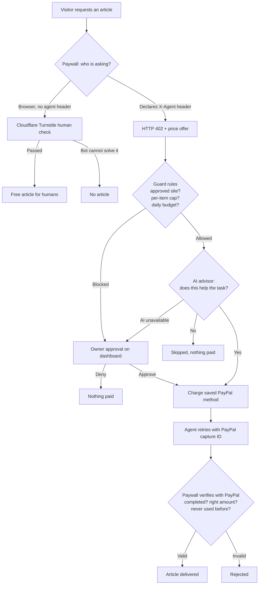
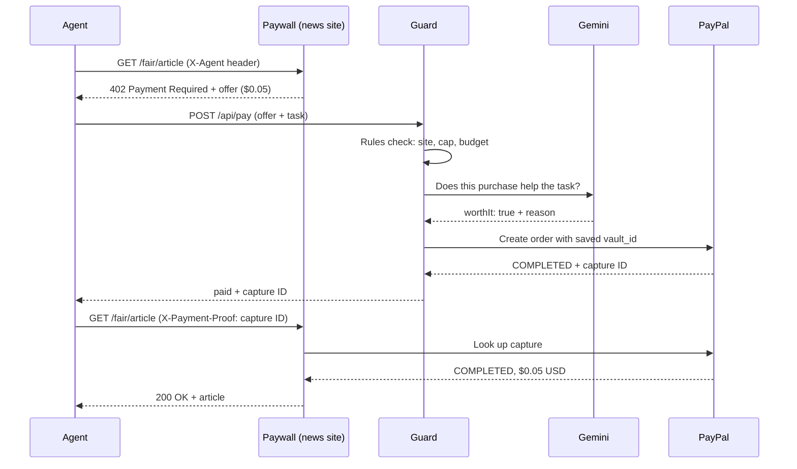
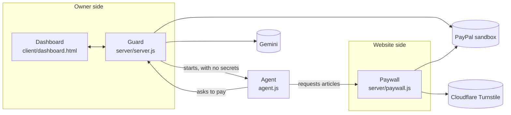

# AI Spending Guard

**Let AI agents pay for content safely — and let websites charge agents while humans read free.**

AI crawlers can now pay websites per article over **HTTP 402 Payment Required**. Two things are missing:
nothing stops an agent from **overspending or paying for junk**, and nothing stops a website from being
"paid" with **fake or reused proof**. AI Spending Guard covers both sides of that payment, using
**PayPal** for the money and **Google Gemini** for judgment.

> Sandbox prototype · no real money · built for the PayPal AI Hackathon 2026

---

## Try it live

| What | Link |
|---|---|
| **Dashboard** (agent owner's view) | https://ai-spend-guard.onrender.com |
| **Demo news site** (website side) | https://ai-spend-guard-paywall.onrender.com/fair/article |

**30-second tour:**

1. Open the **dashboard** and click **Run agent**.
2. Watch the agent visit three paywalled news sites:
   - **Fair News** ($0.05, relevant) → paid automatically.
   - **Gossip Daily** ($0.05, irrelevant) → vetoed by the AI.
   - **Greedy News** ($50.00) → paused for you under **Owner approvals**. Click **Approve** or **Deny**.
3. Check the **Spending log**: every decision with its reason and PayPal capture ID.
4. Open a demo news site **in your browser**: pass the Cloudflare check and read free.
   Then try the same URL **as an agent**:

   ```
   curl -i -H "X-Agent: demo" https://ai-spend-guard-paywall.onrender.com/fair/article
   ```

   You get `HTTP/1.1 402 Payment Required` with a price instead.

Agent runs on the hosted demo are limited to 10 per hour.

---

## How it works

### The big picture



### Side 1: the website — "declare and pay, or prove you're human"

| Visitor | Sends | Gets |
|---|---|---|
| A person in a browser | nothing special | A Cloudflare Turnstile check → **free article** |
| An honest AI agent | `X-Agent: <name>` header | **HTTP 402** with a price → pays → article |
| A bot pretending to be human | nothing special | The human check, which it can't pass |

Lying about being human doesn't get a bot anything, so declaring and paying is the only way in.

When an agent comes back with payment proof, the paywall **asks PayPal directly** whether that capture is
`COMPLETED`, for the **right amount** and currency, and **never used before** (replay protection).
Made-up or recycled proofs are rejected.

### Side 2: the agent owner — "pay for small, sensible things; ask me about the rest"

Every purchase request goes through three layers, in this order:

1. **Rules (code, always first):** approved sites only, a per-item cap ($0.10), and a daily budget ($2.00).
   If the rules block it, the request waits for the owner.
2. **AI advisor (Gemini):** asked only if the rules allow the purchase. It answers one question:
   *does this help the agent's current task?*
   - The AI can only **veto**. It can never approve anything the rules didn't allow.
   - If the AI call fails, the request goes to the owner. It is **never** paid automatically.
3. **Owner (human):** approves or denies paused requests on the dashboard.

Money only moves after these checks, by charging the owner's **vaulted PayPal** payment method.
The owner approved it once; no popup or login is needed for each payment.

### One payment, step by step



---

## Architecture



| Part | File | Holds secrets? | Job |
|---|---|---|---|
| **Guard** | `server/server.js` | Yes: PayPal, vault ID, Gemini | Rules, AI check, payments, approvals, log |
| **Paywall** | `server/paywall.js` | PayPal (to verify only) | 402 offers, human check, payment verification |
| **Agent** | `agent.js` | **No** | Visits sites, asks the guard to pay |
| **Dashboard** | `client/dashboard.html` | No | Run agent, approve/deny, view log |

**The agent never holds payment credentials.** The guard starts it with only its task and two URLs in its
environment, so it cannot reach PayPal, the vault ID, or the Gemini key. Its only way to spend money is to
ask the guard.

---

## PayPal, AI, and other tools

| Technology | Used for |
|---|---|
| **PayPal Orders v2 + Vault** (save during purchase) | Owner approves once; their PayPal is saved for later charges |
| **PayPal Orders v2 with `vault_id`** | Merchant-initiated charges with no buyer present |
| **PayPal Captures API** | Paywall verifies each payment proof with PayPal |
| **PayPal OAuth 2.0** (client credentials) | Server-side authentication |
| **Google Gemini** (`gemini-3.5-flash`) | Veto-only advisor: does this purchase help the agent's task? |
| **Cloudflare Turnstile** (test keys) | Human verification on the paywall |
| **Render** | Hosting for the guard and the paywall |

---

## Run it yourself

### Prerequisites

- **Node.js** 18 or newer
- A **PayPal Developer** account with a **sandbox app** (REST API credentials)
  - Under the app's **Features**, make sure **Save payment methods** is enabled
  - Two sandbox accounts: one **Personal** (the buyer) and one **Business** (the merchant)
- A **Gemini API key** from Google AI Studio

### 1. Install

```
git clone https://github.com/Swarna2503/ai-spend-guard.git
cd ai-spend-guard
npm install
```

### 2. Configure

```
cp .env.example .env
```

Open `.env` and fill in:

```
PAYPAL_CLIENT_ID=your sandbox client ID
PAYPAL_CLIENT_SECRET=your sandbox secret
PAYPAL_VAULT_ID=leave empty for now (see step 4)
GEMINI_API_KEY=your Gemini key
```

### 3. Start everything with one command

```
npm run demo
```

```
[paywall] Paywall running on http://localhost:9000
[guard]   Node server listening at http://localhost:8888/
```

### 4. Connect PayPal (one-time owner setup)

1. Open **http://localhost:8888/connect**.
2. Click the PayPal button and log in with your sandbox **Personal** account (not Business:
   the Business account is the merchant and can't pay itself).
3. Approve the small one-time payment. The vault ID is saved automatically to `data/vault.json`,
   and the dashboard header turns to **PayPal connected**.

**Fallback:** if checkout fails in sandbox, copy `payment_source.paypal.attributes.vault.id`
from the browser console into `PAYPAL_VAULT_ID` in `.env`, then restart `npm run demo`.
If the PayPal popup keeps logging into the Business account, close all private windows,
open a new one, and use "Not you?".

### 5. Use it

Open **http://localhost:8888** and click **Run agent**. Expected result:

| Site | Price | Outcome | Decided by |
|---|---|---|---|
| Fair News | $0.05 | **Paid** automatically | Rules + AI |
| Gossip Daily | $0.05 | **Skipped** (irrelevant) | AI |
| Greedy News | $50.00 | **Paused** for approval | Rules → you |

You can also run the agent from a terminal: `node agent.js`.

### Configuration reference

| Variable | Required | Default | Purpose |
|---|---|---|---|
| `PAYPAL_CLIENT_ID` | Yes | – | PayPal sandbox app |
| `PAYPAL_CLIENT_SECRET` | Yes | – | PayPal sandbox app |
| `PAYPAL_VAULT_ID` | Fallback | – | Used if `data/vault.json` doesn't exist |
| `GEMINI_API_KEY` | Yes | – | AI advisor |
| `PAYWALL_URL` | No | `http://localhost:9000` | Where the agent and dashboard find the paywall |
| `GUARD_URL` | No | `http://localhost:8888` | Where the agent finds the guard |
| `TURNSTILE_SITEKEY` | No | Cloudflare test key | Real key for production |
| `TURNSTILE_SECRET_KEY` | No | Cloudflare test key | Real key for production |

---

## Security decisions

- **The agent gets no secrets.** It's started with a minimal environment and can only spend by asking the guard.
- **The AI can only veto.** A website's description could try to manipulate the AI (prompt injection).
  Even a fooled AI cannot spend beyond the rules.
- **Fail safe.** If the AI is unavailable, requests go to the owner, never straight to payment.
- **Payment proofs are verified with PayPal**, not trusted from the agent, and each proof works only once.
- **No double charges.** Approving marks a request as `charging` before calling PayPal, so a double-click is refused.
- **Untrusted text is never rendered as HTML.** Site descriptions are shown with `textContent` / escaped.
- **Money math in cents** to avoid floating-point errors.
- **Rate limit** on the hosted demo: 10 agent runs per hour.

---

## What I built vs. what I reused

- **Reused:** PayPal's [`docs-examples/save-payment-method`](https://github.com/paypal-examples/docs-examples)
  (Apache 2.0): the checkout page, OAuth helper, and vaulting during purchase.
- **Built:** server-side charging of the vaulted method, the rules engine, the Gemini advisor, the owner
  approval flow, the paywall with HTTP 402 offers, PayPal capture verification and replay protection,
  human verification with Turnstile, the agent, the dashboard, and hosting.

## Inspiration

**CrawlerPal** (PayPal Dev Days 2025 winner) showed that bots can pay websites via HTTP 402 using a vaulted
PayPal method. Its gap: the bot pays whatever it's asked. This project adds the missing spending controls
on the agent side, and human access plus payment verification on the website side.

---

## Honest limits

- **Prototype, sandbox only.** No real money moves.
- **Fees:** in sandbox, a $0.05 payment cost $0.05 in PayPal fees (net $0.00). Real micropayments would
  need batching or special pricing.
- **Single owner:** one saved PayPal method. A real version would store one per user.
- The paywall and guard share one PayPal merchant account. In reality, each website would be the payee.
- Human verification uses Cloudflare Turnstile **test keys** (a "for testing only" banner is visible).
  For production, set real `TURNSTILE_SITEKEY` / `TURNSTILE_SECRET_KEY` from the Cloudflare dashboard.
- Advanced bots can sometimes pass human checks. This raises the cost of lying; it doesn't make it impossible.
- Verified humans aren't remembered: each visit is checked again.
- The approval buttons on the hosted demo are public (sandbox). A real deployment would require owner login.
- Used-proof tracking and the log reset when a server restarts.
- The daily budget resets at midnight **UTC** and counts only autonomous spending (owner-approved payments are separate).
- New-account checkout was unreliable in sandbox during testing; the `.env` vault ID is a fallback.

---

## Demo video

YOUTUBE_LINK_HERE

## License

Apache 2.0. See [`LICENSE`](LICENSE).
