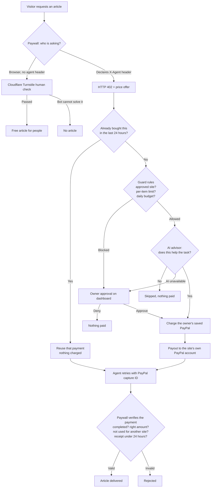
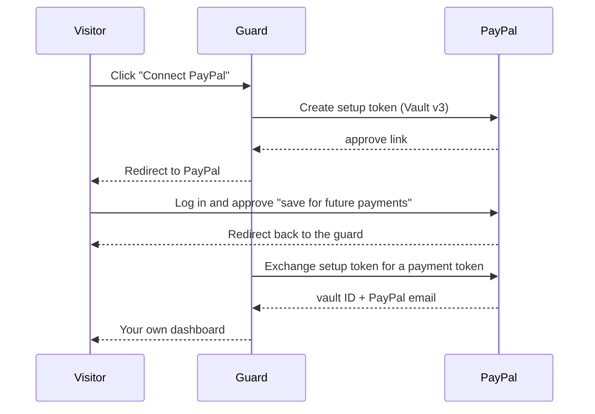
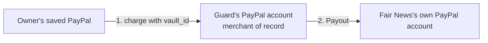

# AI Spending Guard

**Give your AI agent a budget, not your wallet. Websites get paid; people still read free.**

AI crawlers can now pay websites per article over **HTTP 402 Payment Required**. Two things are missing:
nothing stops an agent from **overspending or paying for junk**, and nothing stops a website from being
"paid" with **fake or reused proof**. AI Spending Guard covers both sides of that payment, using
**PayPal** to move the money and **Google Gemini** for judgment.

> Sandbox prototype · play money only · built for the PayPal AI Hackathon 2026

**Who it's for:** people and teams who let AI agents buy data or articles but don't want to hand them a
blank cheque, and publishers who want AI agents to pay instead of scraping, without charging human readers.

---

## Try it live

| What | Link |
|---|---|
| **Dashboard** | https://ai-spend-guard.onrender.com |
| **Demo news site** | https://ai-spend-guard-paywall.onrender.com/fair/article |
| **For creators** | https://ai-spend-guard.onrender.com/publishers.html |

**Three-minute tour:**

1. Open the dashboard and click **Connect PayPal (sandbox)**. Log in with a PayPal sandbox **Personal**
   account (yours, or the demo buyer in the Devpost testing instructions) and approve. You land on
   **your own** dashboard: your own limits, approvals and history.
2. Click **Run agent**. Your agent visits three paywalled news sites:
   - **Fair News** ($0.05, useful) → paid automatically from your PayPal, and the money is sent to
     **Fair News's own PayPal account**.
   - **Gossip Daily** ($0.05, off-topic) → vetoed by the AI.
   - **Greedy News** ($50.00) → paused under **Waiting for your approval**. Approve or deny it.
3. Raise **Your spending limits** (for example $60 per item, $100 per day) and run again. Greedy News now
   passes the rules, and the AI still vetoes it as a rip-off. Two independent checks.
4. Open a news site **in your browser**: pass the Cloudflare check and read free. Then try the same URL
   **as an agent**:

   ```
   curl -i -H "X-Agent: demo" https://ai-spend-guard-paywall.onrender.com/fair/article
   ```

   You get `HTTP/1.1 402 Payment Required` with a price instead.
5. **Run the agent again.** Fair News now shows **Already own Fair News: nothing charged**. The agent reuses
   its earlier payment instead of paying twice for the same article.
6. Click **For creators** to see the publisher side: list a site and set a price for AI agents.

Each visitor can run their agent up to 10 times per hour. The demo agent visits three fixed sites; it doesn't
search the web. The task only guides the AI's purchase decisions.

---

## How it works



### Connecting PayPal (each visitor, once)



No purchase is needed to connect. After that, the guard can charge the visitor's saved PayPal with no popup
or login per payment, but only when the rules, the AI and (if needed) the visitor allow it.

### Side 1: the website, "declare and pay, or prove you're human"

| Visitor | Sends | Gets |
|---|---|---|
| A person in a browser | nothing special | A Cloudflare Turnstile check → **free article** |
| An honest AI agent | `X-Agent: <name>` header | **HTTP 402** with a price → pays → article |
| A bot pretending to be human | nothing special | The human check, which it can't pass |

When an agent comes back with payment proof, the paywall checks with PayPal that the payment is
`COMPLETED`, for the **right amount** and currency. Each proof is then tied to the article it paid for:

| Proof presented | Result |
|---|---|
| New, verified with PayPal | Article delivered; proof recorded for this article |
| Same proof, **same article**, within 24 hours | Article delivered again (a receipt: no second payment) |
| Same proof, **different article** | Rejected: "Proof already used" |
| Same proof, after 24 hours | Rejected: "Receipt expired" |
| Made-up proof | Rejected: PayPal doesn't know it |

Used proofs are saved to disk, so none of this resets when the paywall restarts.

### Side 2: the agent owner, "pay for small, sensible things; ask me about the rest"

Every purchase goes through these checks, in this order:

0. **Already owned?** If the agent bought this site's article in the last 24 hours, the guard reuses that
   payment and charges nothing. It's logged as **Already owned** and doesn't count toward the budget.
1. **Rules (always first):** approved sites only, a per-item limit, and a daily budget. Each owner sets their
   own limits on the dashboard. If the rules block a purchase, it waits for the owner.
2. **AI advisor (Gemini):** asked only if the rules allow the purchase: *does this help the agent's task?*
   - The AI can only **veto**. It can never approve anything the rules didn't allow.
   - If the AI call fails, the request goes to the owner. It is never paid automatically.
3. **Owner:** approves or denies paused requests on the dashboard.

### Where the money goes



### Side 3: creators, "list your site"

The **For creators** page explains the publisher side and lets anyone who has connected PayPal list a site:
name, article URL and the price an AI agent should pay. Listings are validated (only `http`/`https` links,
$0.01 to $100, 5 per account), shown publicly, and removable only by their owner.

Listings are **saved for review, not yet sold to agents**. Going live needs two things this demo
deliberately doesn't fake: a check that the creator owns the site, and the creator's own PayPal account for
payouts.

---

## Architecture

| Part | File | Holds secrets? | Job |
|---|---|---|---|
| **Guard** | `server/server.js` | Yes: PayPal app, Gemini | Connect PayPal, sessions, per-user rules, AI check, payments, payouts, approvals, logs |
| **Paywall** | `server/paywall.js` | PayPal (to verify only) | 402 offers, human check, payment verification, replay protection |
| **Agent** | `agent.js` | **No** | Visits sites, asks the guard to pay |
| **Dashboard** | `client/dashboard.html`, `client/login.html` | No | Connect PayPal, run agent, set limits, approve/deny, view log |
| **Creators page** | `client/publishers.html` | No | Publisher explainer, demo sites, creator listings |

**Every visitor is separate.** A signed, HttpOnly cookie identifies the visitor; their saved PayPal, limits,
log and approvals live in their own folder under `data/users/`. One visitor can't see or spend another's.

**The agent never holds payment credentials.** The guard starts it with only its task, two URLs, and a
one-time token tied to the visitor who clicked **Run agent**. The token lets it ask the guard to pay for that
visitor and check an approval's status, nothing else: it can't change limits, approve its own requests, or
reach PayPal.

---

## PayPal, AI, and other tools

| Technology | Used for |
|---|---|
| **PayPal Vault v3** (setup tokens → payment tokens) | Each visitor saves their PayPal once, without a purchase |
| **PayPal Orders v2 with `vault_id`** | Charges with no buyer present, within the visitor's rules |
| **PayPal Payouts** | Sends each article payment to the site's own PayPal account |
| **PayPal Captures API** | Paywall verifies each payment proof |
| **PayPal OAuth 2.0** (client credentials) | Server-side authentication |
| **Google Gemini** (`gemini-3.5-flash`) | Veto-only advisor: does this purchase help the agent's task? |
| **Cloudflare Turnstile** (test keys) | Human verification on the paywall |
| **Render** | Hosting for the guard and the paywall |

---

## Run it yourself

### Prerequisites

- **Node.js** 18 or newer
- A **PayPal Developer** account with a sandbox **Merchant** app
  - Enable **Save payment methods** and **Payouts** on the app **before** you use its credentials for the
    first time. PayPal reuses an access token for hours, so features enabled later may not apply until it
    expires; if in doubt, create a fresh app.
  - Sandbox accounts: a **Business** account for the app, at least one **Personal** account to connect as a
    user, and optionally a second **Business** account for Fair News
- A **Gemini API key** from Google AI Studio

### 1. Install

```
git clone https://github.com/Swarna2503/ai-spend-guard.git
cd ai-spend-guard
npm install
```

### 2. Configure

```
cp .env.example .env
```

| Variable | Required | Purpose |
|---|---|---|
| `PAYPAL_CLIENT_ID`, `PAYPAL_CLIENT_SECRET` | Yes | Your sandbox app |
| `SESSION_SECRET` | Yes | Any long random text; keeps visitors signed in across restarts |
| `GEMINI_API_KEY` | Yes | AI advisor |
| `FAIR_PAYEE` | No | Fair News's sandbox PayPal email; when set, Fair News payments are paid out to it |
| `PAYWALL_URL`, `GUARD_URL` | No | Defaults: `http://localhost:9000`, `http://localhost:8888` |
| `TURNSTILE_SITEKEY`, `TURNSTILE_SECRET_KEY` | No | Real Cloudflare keys for production (defaults are test keys) |

### 3. Start everything with one command

```
npm run demo
```

```
[paywall] Paywall running on http://localhost:9000
[guard]   Node server listening at http://localhost:8888/
```

### 4. Use it

1. Open **http://localhost:8888** and click **Connect PayPal (sandbox)**.
2. Log in with a sandbox **Personal** account (not the Business account: it's the merchant and can't pay
   itself; if PayPal keeps logging into it, use a fresh private window).
3. Click **Run agent**:

| Site | Price | Outcome (default limits) | Decided by |
|---|---|---|---|
| Fair News | $0.05 | **Paid** automatically, sent to Fair News | Rules + AI |
| Gossip Daily | $0.05 | **Skipped** (off-topic) | AI |
| Greedy News | $50.00 | **Paused** for approval | Rules → you |

To try a second user, open the app in a **different browser** and connect a different sandbox Personal account.

---

## Security decisions

- **Per-visitor isolation.** Each visitor's saved PayPal, limits, log and approvals are separate, identified
  by a signed, HttpOnly cookie.
- **The agent gets no secrets.** It's started with a minimal environment and a one-time token tied to one
  visitor's run.
- **The AI can only veto.** A website's description could try to manipulate the AI (prompt injection);
  even a fooled AI cannot spend beyond the rules.
- **Fail safe.** If the AI is unavailable, requests go to the owner, never straight to payment.
- **Payment proofs are verified with PayPal**, and each proof is tied to one article: it can't be reused on
  another site, and it works again for the same article only for 24 hours. This survives restarts.
- **Never pay twice.** The guard checks the owner's own history before charging, so repeat visits within
  24 hours cost nothing.
- **No double charges.** Approving marks a request as `charging` before calling PayPal.
- **Disconnect means disconnect.** **Disconnect PayPal** deletes the saved payment method at PayPal and
  the visitor's data.
- **Untrusted text is never rendered as HTML.** Site descriptions and creator listings are escaped or shown
  with `textContent`; listing links must be `http` or `https`.
- **Money math in cents** to avoid floating-point errors.

---

## What I built vs. what I reused

- **Started from:** PayPal's [`docs-examples/save-payment-method`](https://github.com/paypal-examples/docs-examples)
  (Apache 2.0), which showed vaulting during a purchase and the OAuth helper pattern.
- **Built:** connecting PayPal without a purchase (Vault setup tokens), multi-user sessions and per-user data,
  server-side charging of saved PayPal methods, payouts to sites, the rules engine and editable limits, the
  Gemini advisor, owner approvals, the paywall with HTTP 402 offers, PayPal payment verification and replay
  protection, 24-hour receipts so an agent never pays twice, human verification with Turnstile, the agent,
  the dashboard, the creators page and listings, and hosting.

## Inspiration

**CrawlerPal** (PayPal Dev Days 2025 winner) showed that bots can pay websites via HTTP 402 using a saved
PayPal method. Its gap: the bot pays whatever it's asked. This project adds the missing spending controls
on the agent side, and human access plus payment verification on the website side.

---

## Honest limits (and what I tested)

- **Prototype, sandbox only.** No real money moves.
- **The guard is the merchant of record.** It charges the owner, then pays the site via Payouts. I tested
  charging a saved PayPal with Fair News as the payee directly: PayPal returned `BILLING_AGREEMENT_NOT_FOUND`,
  because a saved method can only be charged by the merchant it was saved with. Paying sites directly would
  need PayPal's partner platform.
- **The platform verifies, the merchant receives.** Fair News receives each payment in its own account, but
  in sandbox it couldn't look payments up with its own credentials (`NOT_AUTHORIZED` for transaction search;
  payout items can only be read by the sender). So the paywall verifies the owner's payment using the
  guard's PayPal records.
- **Fees:** a $0.05 payment cost $0.05 in fees, and a $0.05 payout cost $0.25. A real version would batch
  payouts per site.
- Only **Fair News** is connected to its own PayPal account; the other demo sites aren't.
- **Sessions, not accounts.** A visitor is identified by a browser cookie. Signing out, or using another
  browser, starts a new session that connects PayPal again.
- **Storage is JSON files**, kept on a 1 GB persistent disk on Render so data survives redeploys. Fine for a
  demo with one server; a production version would use a database such as Postgres.
- **A payment proof is a 24-hour ticket for one article.** Anyone holding the capture ID could read that one
  article for a day. It's only shown in the owner's own dashboard, but a production version would bind
  receipts to the buyer.
- **Creator listings are not sold to agents yet** (no ownership check, no per-creator payouts).
- **The demo agent is scripted:** it visits three fixed sites rather than searching the web.
- Human verification uses Cloudflare Turnstile **test keys** ("for testing only" banner). Advanced bots can
  sometimes pass human checks; this raises the cost of lying, it doesn't make it impossible.
- The daily budget resets at midnight **UTC** and counts only autonomous spending.

---

## What's next

- **Creator marketplace:** publishers verify they own their site, connect their own PayPal, and go live for
  agents, with payouts going straight to them.
- **AI-suggested pricing:** an AI reads each article and suggests a price; the publisher approves it. Same
  principle as the buyer side: AI advises, people decide.
- **A real database** and receipts bound to the buyer.
- **Batched payouts** per site to cut fees.

---

## Demo video

YOUTUBE_LINK_HERE

## License

Apache 2.0. See [`LICENSE`](LICENSE).
